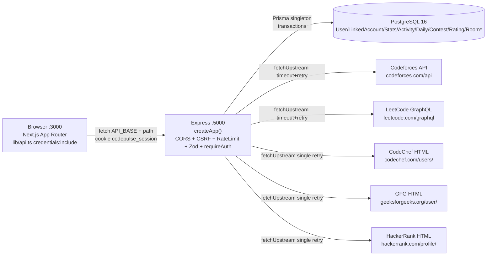
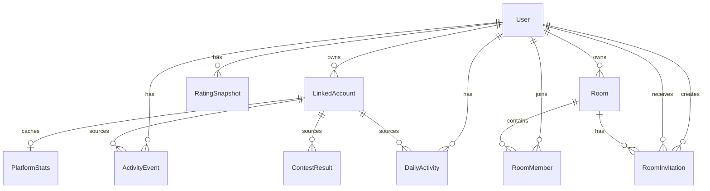
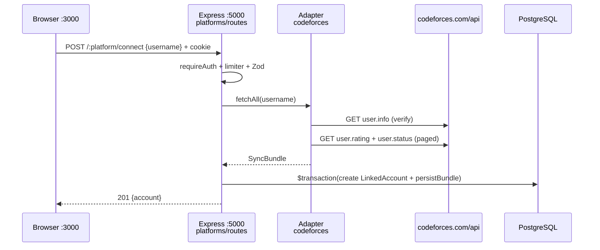
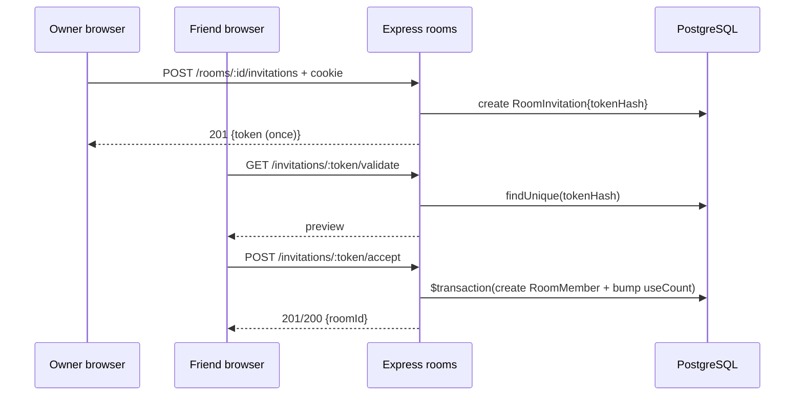

# CodePulse — Project Analysis for Database & API Integration Developer

> **Role:** Database and API Integration Developer (new contributor, did not build original).
> **Scope inspected (read-only):** `README.md`, `package.json`, `.env.example`, `compose.yaml`, `docs/architecture.md`, `docs/cpr-formula.md`, `docs/development-guide.md`, `backend/prisma/schema.prisma`, `backend/prisma/migrations/`, `backend/src/app.ts`, `backend/src/server.ts`, `backend/src/config/env.ts`, `backend/src/db/prisma.ts`, `backend/src/routes/health.ts`, `backend/src/middleware/*`, `backend/src/modules/auth/*`, `backend/src/modules/platforms/*`, `backend/src/modules/codeforces/*`, `leetcode/*`, `codechef/*`, `geeksforgeeks/*`, `hackerrank/*`, `activity/*`, `rating/*`, `analytics/*`, `rooms/*`, `leaderboards/*`, `users/*`, `backend/src/utils/*`, `frontend/src/lib/api.ts`, `frontend/src/app/*`, `frontend/src/components/*`, `packages/shared/src/*`, `backend/tests/*`, `frontend/package.json`, `backend/package.json`.
> **Not inspected exhaustively:** every test assertion line-by-line, every frontend CSS file.
> **Labels used:** **Verified** = seen in code/docs, **Inferred** = reasonable reading but not explicitly stated, **Unknown** = not found.

---

# 1. Executive Summary

## What it does — **Verified**

CodePulse is a **unified competitive-programming analytics platform** — `README.md:1-3`:

> Connect coding profiles from Codeforces, LeetCode, CodeChef, GeeksforGeeks and HackerRank, view statistics in one dashboard, track combined streaks, compare contest ratings, and compete with friends in private rooms.

Problem solved: stats are scattered across 5 sites with different rating scales and no combined streak. CodePulse imports public data server-side, normalises it, stores it in PostgreSQL, and serves unified reads.

Status — **Verified** `README.md:5,260-281`: Modules 0–14 implemented and tested. Real-time Socket.IO leaderboards **planned, not installed**.

## Main capabilities and users — **Verified**

One user role: registered `User`. No admin role in `backend/prisma/schema.prisma:57-82`.

| Capability | Evidence |
|---|---|
| Register/login/logout/me with cookies | `backend/src/modules/auth/routes.ts:13-86` |
| View/edit own profile (`username,displayName,avatarUrl,timezone,showOnLeaderboard`) | `backend/src/modules/users/` + `frontend/src/app/dashboard/page.tsx:199-223` |
| List platforms, connect/sync/disconnect 5 handles | `backend/src/modules/platforms/routes.ts:18-154`, `frontend/src/components/platform-accounts.tsx` |
| Streaks, daily buckets, recent feed | `backend/src/modules/activity/routes.ts:26-98` |
| CodePulse Rating (CPR 0–1000, formula 1.0.0) + history | `backend/src/modules/rating/`, `docs/cpr-formula.md` |
| Analytics summary/trends/compare/platforms/contests/ratings | `backend/src/modules/analytics/`, `frontend/src/app/analytics/page.tsx` |
| Private rooms, hashed invitations, member progress | `backend/src/modules/rooms/`, `frontend/src/app/rooms/`, `frontend/src/app/invite/` |
| Global (public, opt-in) + room (members-only) leaderboards | `backend/src/modules/leaderboards/`, `frontend/src/app/leaderboards/page.tsx` |
| Health checks | `backend/src/routes/health.ts:7,18` `GET /api/health`, `GET /api/health/db` |

## Your area: database and API integrations — **Verified**

You own:

- `backend/prisma/schema.prisma` + `backend/prisma/migrations/` (10 tables, 4 enums).
- `backend/src/db/prisma.ts` singleton + `assertDatabaseConfigured()` + `checkDatabase()`.
- `backend/src/modules/platforms/service.ts` — **all** writes for linked accounts (`persistBundle`, `connectAccount`, `syncAccount`, `disconnectAccount`).
- 5 adapters: `backend/src/modules/{codeforces,leetcode,codechef,geeksforgeeks,hackerrank}/{client.ts,service.ts}` — fetch-only, return `SyncBundle`, never write DB directly.
- All `*/routes.ts` + `*/service.ts` + `*/schemas.ts` (Zod), `packages/shared/src/*` DTOs.

Rule — **Verified** `docs/development-guide.md:60`, `backend/src/modules/platforms/service.ts:26-35`: adapters fetch, orchestration persists. Never invert.

## Overall architecture in plain language

Think of 3 boxes:

1. **Frontend (`frontend/`, Next.js :3000)** — renders pages, calls backend with `fetch(...,{credentials:"include"})` via `frontend/src/lib/api.ts:55-80`. Never calls Codeforces/LeetCode directly. Never stores tokens.
2. **Backend (`backend/`, Express :5000)** — validates (Zod), checks cookie JWT (`requireAuth`), rate-limits, fetches upstream (adapters), writes/reads PostgreSQL via Prisma, returns `{success,message,data}`.
3. **Database (PostgreSQL 16 via `compose.yaml`)** — source of truth for everything the UI shows. Upstream sites are *inputs*; `LinkedAccount/PlatformStats/ActivityEvent/DailyActivity/ContestResult/RatingSnapshot/Room*` are the *cache + history*.

Reads (dashboard, analytics, CPR) aggregate **stored rows only**. Writes (connect/sync) fetch **first**, then transact. One platform outage never wipes another's cache.

## Key findings, uncertainties, immediate priorities

**Verified good:**

- Verify-before-create, null-preserving upserts, `skipDuplicates`, per-account sync locks, SHA-256 invite hashes, generic auth errors, strict Zod, fresh rate-limiter per app.
- 19 backend test files (`backend/tests/`) + frontend Vitest + shared tests; live upstream tests skip without `LIVE_API=1`.

**Uncertainties / Unknown:**

- Production deployment (no Dockerfile, CI, hosting config found).
- Real `JWT_SECRET`, `DATABASE_URL`, `POSTGRES_PASSWORD` values (gitignored, must be supplied).
- Upstream HTML/GraphQL drift rate (best-effort adapters documented as fragile).

**Immediate priorities for you:**

1. Get local DB up (`compose.yaml` + root `.env` from `.env.example`), run `db:validate/generate/migrate/check`.
2. Read `platforms/service.ts:persistBundle` + `schema.prisma` + `platforms/adapters.ts` before touching any adapter.
3. Run backend tests against `codepulse_test` only (never dev DB).

---

# 2. The Five Platforms

**Verified** canonical IDs from `backend/prisma/schema.prisma:26-32` and `backend/src/modules/platforms/schemas.ts:12-17` (case-insensitive in URLs):

`CODEFORCES`, `LEETCODE`, `CODECHEF`, `GEEKSFORGEEKS`, `HACKERRANK`.

Capabilities — **Verified** `backend/src/modules/platforms/registry.ts:27-63`:

- `CODEFORCES`: `profile,stats,activity,contests,sync`
- `LEETCODE`: `profile,stats,activity,contests,sync`
- `CODECHEF`: `profile,stats,contests,sync` (no `activity`)
- `GEEKSFORGEEKS`: `profile,stats,sync` (no activity/contests)
- `HACKERRANK`: `profile,stats,sync` (no activity/contests in DB sense)

## Per-platform detail

### Codeforces — official API — **Verified**

- Purpose: rated contests + accepted submissions with timestamps. Only source of full `PROBLEM_SOLVED` history + `ContestResult` chaining.
- Client: `backend/src/modules/codeforces/client.ts:22` `CODEFORCES_API_BASE=https://codeforces.com/api`, `GET user.info`, `GET user.rating`, `GET user.status` paged (`SUBMISSIONS_PAGE_SIZE=1000`, `MAX_PAGES=10`, `PAGE_DELAY_MS=350`).
- Service: `backend/src/modules/codeforces/service.ts:45-108` — verify via `fetchUserProfile` first, then parallel contests+submissions; `OK` verdicts only, `problemKey(contestId+index)`, `externalId=cf-{id}`, streaks `null`.
- Data owned: handle, rating/rank/max, unique solved count, contest history.

### LeetCode — unofficial GraphQL (best-effort) — **Verified**

- Purpose: profile + difficulty splits + contest rating + recent solves + full daily calendar + attended contests.
- Client: `backend/src/modules/leetcode/client.ts:29` `LEETCODE_GRAPHQL_URL=https://leetcode.com/graphql`, 3 sequential POSTs `PROFILE_QUERY`, `CALENDAR_QUERY`, `CONTEST_HISTORY_QUERY` with browser headers. Header comment `L9-27`: no official API, undocumented, may change.
- Service: `backend/src/modules/leetcode/service.ts:70-103` — `PROBLEM_SOLVED` from recent window only (`lc-{id}`, `titleSlug`), `dailyActivity` from calendar (day counts, no attribution), contests `lc-{slug}` with locally chained ratings. Streaks never derived; missing stays `null`.
- Data owned: username match check, total+Easy/Medium/Hard, contest rating/attended, calendar days.

### CodeChef — HTML profile scrape (best-effort) — **Verified**

- Purpose: rating/division/stars/ranks/solved/contest history when no API exists.
- Client: `backend/src/modules/codechef/client.ts:29` `CODECHEF_PROFILE_BASE=https://www.codechef.com/users/`, single GET, verify via final URL + `m-username--link` marker, regex rating/division/stars/ranks/solved, `var all_rating=[...]` JSON for contests (dates assumed UTC).
- Service: `backend/src/modules/codechef/service.ts:32-65` — `activities:[]` (no timestamps exist), contests `cc-{code}` chained.
- Data owned: current/max rating, division, stars, global/country ranks (`null` when inactive).

### GeeksforGeeks — HTML profile scrape (best-effort) — **Verified**

- Purpose: coding **score** (never rating), solved, institute rank, POD streaks as extras.
- Client: `backend/src/modules/geeksforgeeks/client.ts:32` `GEEKSFORGEEKS_PROFILE_BASE=https://www.geeksforgeeks.org/user/`, decode doubly-encoded `total_problems_solved` stats object via brace scan. Gate = stats object presence (always HTTP 200).
- Service: `backend/src/modules/geeksforgeeks/service.ts:33-55` — `contestRating:null`, `contests:[]`, `activities:[]`, extras hold `score,monthlyScore,podCurrent/LongestStreak`.
- Data owned: score, monthly score, total solved, institute rank.

### HackerRank — HTML profile scrape (best-effort) — **Verified**

- Purpose: badges, domain practice scores, contest count, level/followers.
- Client: `backend/src/modules/hackerrank/client.ts:32` `HACKERRANK_PROFILE_BASE=https://www.hackerrank.com/profile/`, decode `#initialData` JSON `community.viewProfiles.{username}`. Caps `MAX_BADGES=10`, `MAX_DOMAINS=12`.
- Service: `backend/src/modules/hackerrank/service.ts:32-56` — `totalSolved:null` (badge counts overlap, never summed), `contestRating:null` (domain points are scores), `contests:[]`, `activities:[]`.
- Data owned: badges (stars/solved/points), per-domain scores, contest count.

## Comparison table

| Platform | Purpose | Data In (from upstream) | Data Out (to DB as SyncBundle) | Integration Method | Evidence | Confidence |
|---|---|---|---|---|---|---|
| CODEFORCES | Official contests + solves | `user.info`, `user.rating`, `user.status` JSON | `PlatformStats{totalSolved unique OK, contestRating, contestsAttended}`, `ActivityEvent PROBLEM_SOLVED cf-*`, `ContestResult cf-*` | Official REST `https://codeforces.com/api` | `codeforces/client.ts:11-20,149-322`, `service.ts:45-108` | **Verified** |
| LEETCODE | Profile + calendar + contests | GraphQL `matchedUser, submitStatsGlobal, userContestRanking, recentAcSubmissionList, userCalendar, rankingHistory` | `PlatformStats{totalSolved, contestRating}`, recent `PROBLEM_SOLVED lc-*`, `DailyActivity` calendar, `ContestResult lc-*` | Unofficial GraphQL `https://leetcode.com/graphql` | `leetcode/client.ts:9-27,52-107,363-485`, `service.ts:31-103` | **Verified** |
| CODECHEF | Rating + contest history | Profile HTML + `all_rating` embedded JSON | `PlatformStats{rating, solved}`, no activities, `ContestResult cc-*` | HTML scrape `https://www.codechef.com/users/` | `codechef/client.ts:9-27,91-196`, `service.ts:27-68` | **Verified** |
| GEEKSFORGEEKS | Score + solved | Profile HTML embedded stats object | `PlatformStats{totalSolved, contestRating:null}`, extras `score/podStreaks`, no activities/contests | HTML scrape `https://www.geeksforgeeks.org/user/` | `geeksforgeeks/client.ts:9-30,223-259`, `service.ts:26-58` | **Verified** |
| HACKERRANK | Badges + domain scores | Profile HTML `#initialData` JSON | `PlatformStats{totalSolved:null, contestRating:null, contestsAttended:contestTotal}`, extras badges/domains | HTML scrape `https://www.hackerrank.com/profile/` | `hackerrank/client.ts:9-30,125-196`, `service.ts:25-59` | **Verified** |

Shared contract — **Verified** `backend/src/modules/platforms/adapters.ts:13-84`: `NormalizedStats`, `NormalizedActivity{externalId,type,problemId,difficulty,occurredAt}`, `NormalizedContest{externalId,name,contestedAt,ratingBefore/Change/After,rank}`, `SyncBundle{canonicalUsername,stats,activities,contests,dailyActivity?}`, `FetchOptions{sinceId?}`, `PlatformAdapter{platform,fetchAll}`.

Shared errors — **Verified** `backend/src/modules/platforms/errors.ts:8-64`: `invalid-username,not-found,rate-limited,timeout,network,upstream,unsupported,invalid-response`.

> Do not guess names/roles beyond this. If a sixth platform is mentioned elsewhere, mark as **Unknown** — none found.

---

# 3. Technology Stack and Repository Structure

## Languages, frameworks, DB, API tools — **Verified**

| Tech | Version / File | Why used (**Verified** + **Inferred**) |
|---|---|---|
| TypeScript `strict:true` | all `tsconfig.json` | Type safety across frontend/backend/shared. **Verified** `docs/development-guide.md:86`. |
| Node.js >=20, npm >=10 | `package.json:36-39`, `README.md:43-44` | Runtime + workspaces. **Verified**. |
| npm workspaces | `package.json:6-10` `frontend,backend,packages/shared` | Monorepo sharing DTOs. **Verified**. |
| Next.js App Router 15, React 19 | `frontend/package.json:18-20` | Frontend pages `frontend/src/app/`. **Verified**. |
| Tailwind 3 + shadcn/ui pattern + `cn()` + `lucide-react` | `frontend/package.json:14-22`, `frontend/src/components/ui/`, `frontend/src/lib/utils.ts` | Styling. **Verified** `README.md:13-14`. |
| Recharts 3 | `frontend/package.json:21` | Dashboard/analytics/rating charts. **Verified**. |
| Express 4 | `backend/package.json:27` | HTTP API `backend/src/app.ts`. **Verified**. |
| Prisma 6 + `@prisma/client` + PostgreSQL 16 | `backend/package.json:22,41`, `backend/prisma/schema.prisma:21-24`, `compose.yaml:19` | ORM + DB. **Verified**. |
| Zod 3 | `backend/package.json:30` | Env (`config/env.ts`) + request validation. **Verified**. |
| bcryptjs (cost 12) | `backend/package.json:23`, `backend/src/modules/auth/password.ts` | Password hashing. **Verified**. |
| jsonwebtoken HS256 + cookie-parser + cors + express-rate-limit | `backend/package.json:24-28` | Cookie JWT sessions, CORS, throttling. **Verified**. |
| dotenv + dotenv-cli | `backend/package.json:26,40` | Load root `.env` for backend + Prisma CLI. **Verified** `config/env.ts:13-23`. |
| tsx (watch), tsc, eslint, Vitest, Supertest, concurrently | `backend/package.json:32-45`, `frontend/package.json:24-35`, `package.json:34` | Dev-run, checks, tests. **Verified**. |
| Docker Compose (Postgres only) | `compose.yaml:17-40` | Local DB `postgres:16-alpine`, localhost-only, volume `codepulse_pgdata`, healthcheck. **Verified**. No app Dockerfile found — **Verified absent**. |
| Socket.IO / Redis / BullMQ / email / CI | — | **Verified absent** `docs/architecture.md:93-95`. Real-time planned, not installed. |

Why each: frontend owns rendering/routing, backend owns HTTP/validation/auth/logic/DB, shared owns serialisable contracts (acyclic) — **Verified** `docs/architecture.md:57-61`.

## Important folders/files — **Verified** via directory reads

```text
CodePulse/
  package.json              # workspaces + dev/build/lint/test/db:* scripts
  .env.example              # template (names only, no secrets)
  .gitignore                # ignores .env, node_modules, .next, dist
  compose.yaml              # local postgres
  README.md                 # setup, endpoints, troubleshooting, status
  docs/architecture.md      # layout, lifecycle, auth model
  docs/cpr-formula.md       # CPR v1.0.0 spec
  docs/development-guide.md # module/test/migration conventions
  backend/src/app.ts        # createApp() factory
  backend/src/server.ts     # listen() only
  backend/src/config/env.ts # Zod env
  backend/src/db/prisma.ts  # singleton + assert + check
  backend/src/scripts/db-check.ts
  backend/src/middleware/csrf.ts, errorHandler.ts, notFound.ts
  backend/src/modules/auth/, users/, platforms/,
    codeforces/, leetcode/, codechef/, geeksforgeeks/, hackerrank/,
    activity/, rating/, analytics/, rooms/, leaderboards/
  backend/src/utils/httpError.ts, streaks.ts, activity.ts
  backend/src/routes/health.ts
  backend/prisma/schema.prisma
  backend/prisma/migrations/ (7 + lock)
  backend/tests/ (19 files)
  frontend/src/app/page.tsx, layout.tsx, globals.css
    register/, login/, dashboard/, analytics/, rooms/, rooms/[id]/,
    invite/[token]/, leaderboards/
  frontend/src/lib/api.ts (central client), dashboard.ts, analytics.ts, rooms.ts, leaderboards.ts
  frontend/src/components/cpr-card, streak-card, activity-heatmap,
    recent-activity, platform-accounts, analytics-charts, ui/
  packages/shared/src/index.ts, auth.ts, platforms.ts, activity.ts,
    rating.ts, analytics.ts, rooms.ts, leaderboards.ts
```

## Manifests, scripts, lockfiles, config — **Verified**

Root `package.json:11-31`:

- `dev:frontend` → `next dev` (:3000), `dev:backend` → `tsx watch src/server.ts` (:5000), `dev` → `concurrently` both.
- `lint:frontend` (eslint), `lint:backend` (`tsc --noEmit`), `test` (all workspaces), `typecheck`, `build`, `db:generate/migrate/deploy/validate/check/studio` → delegate to backend `dotenv -e ../.env -- prisma ...` + `tsx src/scripts/db-check.ts`.
- `package-lock.json` present (365KB). `engines: node>=20,npm>=10`.

Backend `backend/package.json:6-18`: `dev/build/start/lint/typecheck/test(vitest run)/prisma:*/db:check/studio`.

Frontend `frontend/package.json:5-11`: `dev/build/start/lint/eslint/typecheck/test`.

Shared `packages/shared/package.json`: `build/typecheck/test/lint` via `tsc` + `vitest`.

Config: `backend/src/config/env.ts:33-74` Zod (`NODE_ENV,PORT,FRONTEND_URL` boot; `DATABASE_URL` optional for boot but required for DB ops; `JWT_SECRET` ≥32 in prod; `*_TIMEOUT_MS` default 10000). `frontend/next.config.ts` empty. `frontend/.env.example:3` `NEXT_PUBLIC_API_URL=http://localhost:5000`. `compose.yaml:21-39` env from root `.env`, `127.0.0.1:${POSTGRES_PORT}:5432`, named volume, `pg_isready` healthcheck.

Docs: `architecture.md` (layout, lifecycle, auth), `cpr-formula.md` (weights/ceilings/policy), `development-guide.md` (module/test/migration/convention rules).

## Entry points + startup — **Verified**

- Backend: `backend/src/server.ts:1-10` imports `createApp`, `env`, calls `app.listen(env.PORT)`. `backend/src/app.ts:30-74` builds middleware → health → CSRF+routers → 404 → error handler. `trust proxy=1`. Test override `createApp({platformAdapters})`.
- Frontend: `frontend/src/app/layout.tsx` + `page.tsx` (`/` welcome), then `/register`, `/login`, `/dashboard`, `/analytics`, `/rooms`, `/leaderboards`, `/invite/[token]`. All dashboard-family pages are `"use client"`.
- DB: `backend/prisma/schema.prisma:21-24` `provider=postgresql url=env("DATABASE_URL")`.
- Shared: `packages/shared/src/index.ts:7-29` `ApiResponse<T>`, `ok()`, `fail()` + re-exports.

---

# 4. Architecture Overview

## Components — **Verified**

- **Frontend:** Next.js App Router, parallel `apiFetch` calls, per-section loading/error/empty states (`frontend/src/app/dashboard/page.tsx:173-181`). Styling Tailwind + `cn()`. Charts Recharts.
- **Backend:** Express + TS, factory routers (`create*Router()` fresh rate-limiters per `createApp()`), Zod at boundary, `requireAuth` for identity, services for logic, Prisma for DB, adapters for upstream.
- **Database:** PostgreSQL, Prisma singleton, cascading deletes, unique guards, transactional writes.
- **External:** Codeforces REST, LeetCode GraphQL, CodeChef/GFG/HackerRank HTML. All server-side; browser never calls upstream — **Verified** `docs/architecture.md:81`.
- **Shared:** `@codepulse/shared` DTOs imported by both sides, never reverse — **Verified** `docs/architecture.md:61`.

## Mermaid architecture diagram (verified only)



Unknown connections: none for local dev. Production reverse proxy / hosting / Socket.IO marked **Unknown / Not found** (planned, not installed).

## Diagram in beginner terms

Your browser talks only to CodePulse's backend (port 5000). The backend checks who you are (cookie), checks your input (Zod), then either reads/writes the database or, for connect/sync, asks the 5 coding sites for public data. It saves a cleaned copy in the DB so the dashboard can show it later without re-asking those sites every page load.

## Sync vs async flows — **Verified**

- **Synchronous (no queue):** connect/sync do `fetch → transact → respond` in one HTTP request — `backend/src/modules/platforms/service.ts:366-398,488-518`. Per-account in-memory `syncLocks:Set` gives 409 on concurrent sync. No Redis/BullMQ/queue found.
- **Parallel reads:** dashboard fires 5 GETs concurrently; each degrades alone — `frontend/src/app/dashboard/page.tsx:173-181`.
- **Lazy idempotent:** CPR `GET /api/rating` recomputes and inserts only on changed `inputsHash` — `docs/cpr-formula.md:69-77`.

## Where cross-cutting happens — **Verified**

- AuthN: `backend/src/modules/auth/middleware.ts:24-56` `requireAuth` (cookie → JWT → DB reload → `req.authUser`).
- AuthZ: own-data by session id; rooms membership/owner checks in `rooms/service.ts`; global leaderboard opt-in (`showOnLeaderboard`), room board membership — `leaderboards/routes.ts:25-71`.
- Validation: Zod `safeParse` in every `routes.ts` + `schemas.ts`, `.strict()` rejects extras.
- Errors: `HttpError(status)` → `middleware/errorHandler.ts:5-32` (4xx passthrough, 500 generic in prod), `notFound.ts:3-8` JSON 404, `PlatformError→HttpError` map `platforms/service.ts:85-112`.

---

# 5. Database Deep Dive

Engine + access — **Verified**: PostgreSQL 16 (`compose.yaml:19`), Prisma ORM v6 (`@prisma/client ^6.19.3`, `prisma ^6.19.3`), singleton `backend/src/db/prisma.ts:11-16`, config `backend/prisma/schema.prisma:21-24` `url=env("DATABASE_URL")`.

Schemas/models/migrations/config — **Verified**:

- Schema: `backend/prisma/schema.prisma:1-272`.
- Migrations: `backend/prisma/migrations/` 7 + `migration_lock.toml(provider=postgresql)`:
  - `20261010143048_init` — enums + `User,LinkedAccount,PlatformStats,ActivityEvent,RatingSnapshot,Room,RoomMember`.
  - `20261010163354_add_syncing_status_and_contest_results` — `ConnectionStatus.SYNCING` + `ContestResult`.
  - `20261011054654_add_rating_formula_version` — `RatingSnapshot.formulaVersion DEFAULT '1.0.0'`.
  - `20261011070247_add_rooms_invitations_leaderboard_optout` — `User.showOnLeaderboard` + `RoomInvitation` (link invites).
  - `20261011132115_add_submission_activity_type` — `ActivityType.SUBMISSION`.
  - `20261011150523` — `DailyActivity`.
  - `20261011162829_add_invitation_recipient` — `RoomInvitation.invitedUserId`.
- No seeds found — **Unknown / Not found** (none in repo listing).
- Repositories: none as separate layer; services call `prisma.*` directly — **Verified**.

## Tables (purpose + columns) — **Verified** `schema.prisma`

### `User` (`:57-82`) — CodePulse account, never platform credentials

| Column | Type | Null | Default | Constraints |
|---|---|---|---|---|
| `id` | UUID | No | `uuid()` | PK |
| `username` | String | No | — | UNIQUE + index |
| `email` | String | No | — | UNIQUE + index |
| `passwordHash` | String | No | — | — |
| `displayName` | String? | Yes | — | — |
| `avatarUrl` | String? | Yes | — | — |
| `timezone` | String | No | `"UTC"` | — |
| `showOnLeaderboard` | Boolean | No | `false` | — |
| `createdAt` | DateTime | No | `now()` | — |
| `updatedAt` | DateTime | No | — | `@updatedAt` |

Relations: `linkedAccounts[], activityEvents[], dailyActivities[], ratingSnapshots[], roomsOwned[] (RoomOwner), roomMemberships[], invitationsCreated[] (InvitationCreator), invitationsReceived[] (InvitationRecipient)`.

### `LinkedAccount` (`:84-104`) — one row per user×platform link

`id UUID PK`, `userId UUID FK User.id CASCADE`, `platform Platform`, `platformUsername String`, `connectionStatus ConnectionStatus DEFAULT PENDING`, `lastSyncedAt DateTime?`, `lastSyncError String?`, `createdAt`, `updatedAt`. `@@unique([userId,platform])`, `@@index([userId])`, `@@index([platform])`. Relations `stats?, activityEvents[], dailyActivities[], contestResults[]`.

### `PlatformStats` (`:106-118`) — latest cached stats per link (nullable = unknown, never 0)

`id UUID PK`, `linkedAccountId UUID UNIQUE FK CASCADE`, `totalSolved Int?`, `contestRating Decimal(10,2)?`, `contestsAttended Int?`, `currentStreak Int?`, `longestStreak Int?`, `additionalStats Json?`, `fetchedAt DEFAULT now()`.

### `ActivityEvent` (`:120-143`) — verified solves / contests / submissions

`id UUID PK`, `userId UUID FK CASCADE`, `linkedAccountId UUID FK CASCADE`, `platform Platform`, `externalActivityId String?`, `activityType ActivityType`, `problemIdentifier String?`, `difficulty String?`, `occurredAt DateTime`, `createdAt`. `@@unique([linkedAccountId,externalActivityId])` (NULLs don't collide in PG), `@@index([userId,occurredAt])`, `@@index([linkedAccountId])`. App dedup when no external id: `(linkedAccountId,platform,activityType,problemIdentifier,occurredAt)`.

### `DailyActivity` (`:153-173`) — LeetCode calendar day aggregates

`id UUID PK`, `userId FK CASCADE`, `linkedAccountId FK CASCADE`, `platform`, `date DATE (UTC midnight)`, `submissions Int`, `source DEFAULT LEETCODE_CALENDAR`, `syncedAt`, `createdAt`, `updatedAt`. `@@unique([linkedAccountId,platform,date])`, `@@index([userId,date])`, `@@index([linkedAccountId])`. Missing day = no verified activity, never assumed.

### `ContestResult` (`:179-195`) — rated participations

`id UUID PK`, `linkedAccountId FK CASCADE`, `platform`, `externalContestId String`, `contestName`, `contestedAt`, `ratingBefore?`, `ratingChange?`, `ratingAfter?`, `rank?`, `createdAt`. `@@unique([linkedAccountId,externalContestId])`, `@@index([linkedAccountId,contestedAt])`.

### `RatingSnapshot` (`:197-213`) — immutable CPR history

`id UUID PK`, `userId FK CASCADE`, `rating Decimal(7,2)`, `contestScore Decimal(7,2)`, `problemSolvingScore Decimal(7,2)`, `consistencyScore Decimal(7,2)`, `coverageMetadata Json?`, `formulaVersion DEFAULT 1.0.0`, `calculatedAt DEFAULT now()`. `@@index([userId,calculatedAt])`.

### `Room` (`:215-229`) — private competition group

`id UUID PK`, `name`, `description?`, `inviteCode UNIQUE` (legacy 9B base64url), `ownerId UUID FK CASCADE`, `createdAt`, `updatedAt`. `@@index([ownerId])`. Relations `members[], invitations[]`.

### `RoomInvitation` (`:240-258`) — hashed token invites

`id UUID PK`, `roomId FK CASCADE`, `tokenHash UNIQUE (SHA-256)`, `createdById FK CASCADE`, `invitedUserId? FK CASCADE (null=link, set=in-app)`, `expiresAt`, `revokedAt?`, `usedAt?`, `maxUses DEFAULT 1`, `useCount DEFAULT 0`, `createdAt`. `@@index([roomId])`, `@@index([invitedUserId])`.

### `RoomMember` (`:260-272`) — membership (race guard)

`id UUID PK`, `roomId FK CASCADE`, `userId FK CASCADE`, `role RoomRole DEFAULT MEMBER`, `joinedAt`. `@@unique([roomId,userId])`, `@@index([roomId])`, `@@index([userId])`.

Enums — **Verified** `:26-55`: `Platform(5)`, `ConnectionStatus(PENDING,CONNECTED,SYNCING,DISCONNECTED,ERROR)`, `ActivityType(PROBLEM_SOLVED,CONTEST_PARTICIPATION,SUBMISSION)`, `RoomRole(OWNER,MEMBER)`.

## ER diagram (verified relations)



Cardinalities: 1 User → N LinkedAccount (but `@@unique(userId,platform)` = max 1 per platform); 1 LinkedAccount → 0/1 PlatformStats; 1 LinkedAccount → N Activity/Daily/Contest; 1 Room → N Members/Invites; all FKs `onDelete:Cascade` — **Verified** schema + migration SQL tails.

## Important queries + transactions — **Verified**

Central writes `backend/src/modules/platforms/service.ts`:

- `listLinkedAccounts:149-153` `findMany({where:{userId},include:{stats:true},orderBy:{createdAt:asc}})`.
- `persistBundle:196-330` (`PERSIST_CHUNK_SIZE=1000`): `platformStats.upsert` null-guarded (unknown≠zero, `:215-229`); `activityEvent.createMany({skipDuplicates:true})` chunked; `contestResult.createMany({skipDuplicates:true})`; `dailyActivity.upsert({where:{linkedAccountId_platform_date}})` overwrite never sum; if `daily.complete` → `activityEvent.deleteMany({SUBMISSION on imported days})` same txn.
- `connectAccount:347-398`: `findUnique({userId_platform})` 409 pre-check → fetch outside txn → `prisma.$transaction(create LINKED + persistBundle)` → `P2002` race → 409.
- `disconnectAccount:402-417`: `findUnique` 404 → `delete({id})` cascade wipes stats/activities/contests, user untouched.
- `syncAccount:456-527`: `syncLocks:Set` 409 if in-flight → `update({SYNCING})` → Codeforces `sinceId=max(cf-*)` via `getMaxKnownSubmissionId:433-446` → fetch → fail path `update({ERROR,lastSyncError:sanitized})` preserve cache → success `$transaction(persistBundle + update({CONNECTED,lastSyncedAt}))` with `resolveTotalSolved:171-194` union for incremental.
- `sanitizeSyncError:450-454` truncates 300 chars, generic fallback.

Reads:

- Activity `backend/src/modules/activity/service.ts:60-99,244-253`: per-account `aggregate({_count,_min/_max})` for coverage; `count + findMany({where:{userId,platform?,type?},include:{linkedAccount:{platformUsername}},orderBy:[occurredAt desc,id desc],take/skip})`.
- Unified merge `backend/src/utils/activity.ts:117-159` `fetchUnifiedActivity`: `Promise.all(findMany ActivityEvent + findMany DailyActivity padded ±2d)` → `mergeActivityRows` dedups LeetCode events on calendar days, expands daily as UTC-midnight `SUBMISSION`.
- Analytics `backend/src/modules/analytics/service.ts:251-324,379-402,449-458,488-498`: `findMany linkedAccount include stats`, `findFirst ratingSnapshot desc`, `count/findMany contestResult include linkedAccount`, `findMany contestResult(ratingAfter not null, take 500) + ratingSnapshot(take 500)`.
- Rating `backend/src/modules/rating/service.ts:118-125,213-270`: `findMany linkedAccount include stats`, `groupBy activity/daily by platform`, `findFirst latest`, compare `inputsHash+formulaVersion`, `create` only on diff, `findMany history desc take limit`.
- Rooms `backend/src/modules/rooms/service.ts:136-244,277-333,430-567,614-648`: `$transaction(create room+owner)`, `$transaction(leave/transfer/delete)`, `findMany pending invitedUserId` dedup, `create({tokenHash:sha256,...})`, `$transaction(accept: find invite + find member idempotent + count<100 + create + update useCount)` with `P2002→alreadyMember`.
- Leaderboards `backend/src/modules/leaderboards/service.ts:131-346`: `findMany ratingSnapshot take 4000 → latest-per-user`, single `$queryRaw` UNION Activity+Daily with `generate_series`, `findMany activity/daily take 200k → merge → computeStreaks UTC`.
- Auth/Users `auth/service.ts:28-70`, `users/service.ts:7-46`: `user.create` with `P2002→409`, `findUnique({email/id})`, `user.update` whitelisted 5.

Duplicate prevention — **Verified**: DB uniques (`[userId,platform]`, `[linkedAccountId,externalActivityId]`, `[linkedAccountId,platform,date]`, `[linkedAccountId,externalContestId]`, `[roomId,userId]`, `tokenHash`) + `skipDuplicates` + app union + `syncLocks` + transactions.

Deletion/update — **Verified**: disconnect/room/user deletes cascade; `lastSyncedAt` only on success; null incoming stats never wipe known values; daily upserts overwrite; `SUBMISSION` cleanup only on `complete` import days.

Migrations + safe setup — **Verified** `docs/development-guide.md:29-55`, `README.md:47-72,103-119`: `docker compose up -d` → `ps` healthy → one-time `CREATE DATABASE codepulse_test` → `npm run db:validate/generate/migrate/check` (root `.env` auto-loaded via dotenv-cli). Never edit applied migration; `migrate dev` prompts for name; tests only on `codepulse_test` via shell `DATABASE_URL` override; never `migrate reset/down -v/db push` on real data.

Ownership/source-of-truth — **Verified**: upstream is input, DB is truth for UI; disconnected platform contributes nothing (never zero) — `docs/cpr-formula.md:67`; failed sync preserves cache + `lastSyncedAt`.

Concerns (with refs, not claims without evidence):

- `dailyActivity.upsert` uses `Promise.all` per chunk inside txn (`service.ts:274-300`) — **Verified** potential txn contention under large backfills (chunked to 1000 to bound).
- `syncLocks` in-memory (`:425`) — **Verified** single-instance only; multi-instance deploys would need DB/advisory lock (see §12).
- Leaderboard `take 4000/200k` caps (`leaderboards/service.ts`) — **Verified** pagination-safe but full-scan heavy at scale.
- Raw SQL in leaderboards `$queryRaw` uses `Prisma.sql` templating — **Verified** no string concat injection, but review on change.

Do not connect/modify DB — per your rules, no live DB calls made for this report.

---

# 6. API Integration Deep Dive

## Route/handler/service/middleware inventory — **Verified**

App composition — **Verified** `backend/src/app.ts:30-74` (see §4). All routers are factories (`create*Router()`) for fresh limiters + test adapter injection.

### API inventory table (local vs third-party split)

**Local application endpoints (all verified in code):**

| Integration | Method | Route/Event | Purpose | Auth | Request | Response | Files | Status |
|---|---|---|---|---|---|---|---|---|
| Health | GET | `/api/health` | Liveness | none | — | `{success,message,timestamp}` | `routes/health.ts:7-13` | **Verified** |
| Health | GET | `/api/health/db` | DB connectivity | none | — | `{success,data:{database,latencyMs},timestamp}` 200/503 | `routes/health.ts:18-35`, `db/prisma.ts:40-48` | **Verified** |
| Auth | POST | `/api/auth/register` | Create user + cookie | public+CSRF | `{username,email,password,displayName?}` strict | `201 {user:SafeUser}` + cookie; 400+issues; 409; 429 | `auth/routes.ts:16-42`, `schemas.ts:31-43`, `service.ts:28-50` | **Verified** |
| Auth | POST | `/api/auth/login` | Cookie login | public+CSRF | `{email,password}` strict | `200 {user}` + cookie; 400; 401 generic; 429 | `auth/routes.ts:44-70`, `schemas.ts:45-52` | **Verified** |
| Auth | POST | `/api/auth/logout` | Clear cookie | none | — | `200` + clear | `auth/routes.ts:72-75` | **Verified** |
| Auth | GET | `/api/auth/me` | Current user | cookie | — | `200 {user}`; 401 | `auth/routes.ts:77-83` | **Verified** |
| Users | GET | `/api/users/me` | Safe profile | cookie | — | `200 {user}` | `users/routes.ts` | **Verified** |
| Users | PATCH | `/api/users/me` | Edit 5 fields | cookie+CSRF | strict 5-field, ≥1 key | `200 {user}`; 400; 409 username | `users/schemas.ts`, `service.ts` | **Verified** |
| Platforms | GET | `/api/platforms` | Metadata + capabilities | none | — | `{platforms:PlatformInfo[]}` | `platforms/routes.ts:19-31`, `registry.ts` | **Verified** |
| Platform-accounts | GET | `/api/platform-accounts` | Own links + stats | cookie | — | `{accounts:LinkedAccountDto[]}` | `platforms/routes.ts:48-59` | **Verified** |
| Platform-accounts | POST | `/api/platform-accounts/:platform/connect` | Verify + import | cookie+CSRF, 30/hour | `{username}` | `201 {account}`; 400; 409; 429; 502 | `platforms/routes.ts:61-101`, `service.ts:347-398` | **Verified** |
| Platform-accounts | DELETE | `/api/platform-accounts/:platform` | Unlink + cascade | cookie+CSRF | param enum | `200 {account:{platform,username}}`; 404 | `platforms/routes.ts:103-123`, `service.ts:402-417` | **Verified** |
| Platform-accounts | POST | `/api/platform-accounts/:platform/sync` | Refresh | cookie+CSRF, 20/hour | — (+`sinceId` internal CF) | `200 {account}`; 404; 409 in-flight; 502 preserve | `platforms/routes.ts:125-151`, `service.ts:456-527` | **Verified** |
| Activity | GET | `/api/activity/streak?timezone=` | Streak + coverage + totals | cookie | `{timezone? IANA}` | `{streak,coverage,totals}` | `activity/routes.ts:26-47` | **Verified** |
| Activity | GET | `/api/activity/days?days&end&timezone` | Buckets | cookie | `{days 1-732, end YYYY-MM-DD, timezone?}` | `{days,range,timezone}` | `activity/routes.ts:49-71` | **Verified** |
| Activity | GET | `/api/activity/recent?limit&offset&platform&type` | Feed | cookie | `{limit 1-100, offset, platform?, type?}` | `{items,pagination}` | `activity/routes.ts:73-95` | **Verified** |
| Rating | GET | `/api/rating` | Lazy CPR | cookie | — | `CprDto + snapshotCreated` | `rating/routes.ts:31-37` | **Verified** |
| Rating | POST | `/api/rating/recalculate` | Idempotent recalc | cookie+CSRF | — | same, diff message | `rating/routes.ts:39-45` | **Verified** |
| Rating | GET | `/api/rating/history?limit=` | Snapshots desc | cookie | `{limit 1-100}` | `{snapshots}` | `rating/routes.ts:47-67` | **Verified** |
| Analytics | GET | `/api/analytics/summary?...` | Totals + streak + CPR | cookie | range preset XOR custom + tz | `AnalyticsSummaryDto` | `analytics/routes.ts`, `service.ts:251-324` | **Verified** |
| Analytics | GET | `/api/analytics/trends?...` | Buckets daily/weekly/monthly | cookie | same | `{buckets,kind,range,timezone}` | same | **Verified** |
| Analytics | GET | `/api/analytics/compare?...` | Current vs prev | cookie | same | `PeriodComparisonDto` | `service.ts:379-402` | **Verified** |
| Analytics | GET | `/api/analytics/platforms?...` | Per-platform rows | cookie | same | `{platforms,range}` | same | **Verified** |
| Analytics | GET | `/api/analytics/contests?limit&offset` | Contest history desc | cookie | `{limit,offset}` | `{items,pagination}` | `service.ts:449-458` | **Verified** |
| Analytics | GET | `/api/analytics/ratings` | Native + CPR points | cookie | — | `{ratings,cpr}` cap 500 | `service.ts:488-498` | **Verified** |
| Rooms | POST | `/api/rooms/` | Create (owner) | cookie+CSRF, 20/hour | `{name 1-60, description? ≤500}` strict | `201 {room:RoomDto}` | `rooms/routes.ts:58-70` | **Verified** |
| Rooms | GET | `/api/rooms/` | Own rooms | cookie | — | `{rooms}` | `:72-79` | **Verified** |
| Rooms | GET/ PATCH/DELETE | `/api/rooms/:id` | Details/update/delete | cookie, members (update/delete owner) | uuid + strict body | `200 {room}`; non-member 404 | `:155-191` | **Verified** |
| Rooms | POST | `/api/rooms/:id/leave` | Leave/transfer/delete | cookie member | uuid | `{left,roomDeleted,transferredToUsername}` | `:193-210` | **Verified** |
| Rooms | GET | `/api/rooms/:id/members` | Members | cookie member | uuid | `{members:RoomMemberDto[]}` | `:212-221` | **Verified** |
| Rooms | GET | `/api/rooms/:id/progress` | Per-member CPR/streak/solved | cookie member | uuid | `{progress:RoomMemberProgressDto[]}` nulls never zero | `:226-235` | **Verified** |
| Rooms | DELETE | `/api/rooms/:id/members/:userId` | Kick (not self) | cookie owner | uuids | `200`; 400 self; 404 | `:237-248` | **Verified** |
| Rooms | POST | `/api/rooms/:id/invitations` | Mint token (once) | cookie owner, 20/hour | `{expiresInHours 1-720, maxUses 1-100, username?}` | `201 {invitation,token,acceptPath}` | `:250-264` | **Verified** |
| Rooms | GET | `/api/rooms/:id/invitations` | List (no tokens) | cookie owner | uuid | `{invitations}` | `:266-275` | **Verified** |
| Rooms | GET | `/api/rooms/invitations/:token/validate` | Preview | cookie, 60/hour | token 32-64 b64url | `InvitationPreviewDto`; generic 404 | `:118-127` | **Verified** |
| Rooms | POST | `/api/rooms/invitations/:token/accept` | Join (idempotent) | cookie | token | `200/201 {roomId,alreadyMember}` | `:129-142` | **Verified** |
| Rooms | POST | `/api/rooms/invitations/:invitationId/revoke` | Revoke (idempotent) | cookie owner | uuid | `200 {invitation}` | `:144-153` | **Verified** |
| Rooms | GET/POST | `/api/rooms/invitations/received*` | In-app invites | cookie recipient | uuid | `{invitations}/{roomId,alreadyMember}` | `:83-116` | **Verified** |
| Leaderboards | GET | `/api/leaderboards/global?...` | Public board | public (optional session for `me`), 300/hour | `{metric cpr/activity/solved/streak, period 7d/30d/90d, page, limit 1-100}` | `LeaderboardPageDto{entries,pagination,me,note}` | `leaderboards/routes.ts:25-41` | **Verified** |
| Leaderboards | GET | `/api/leaderboards/rooms/:roomId?...` | Room board | cookie + member (404 else) | same + uuid | same shape | `:43-70` | **Verified** |

**Third-party APIs (server-side only, no keys):**

| Upstream | Method | Endpoint/Event | Purpose | Auth | Files | Status |
|---|---|---|---|---|---|---|
| Codeforces | GET | `https://codeforces.com/api/user.info?handle=` | Verify + rating/rank | none (public) | `codeforces/client.ts:172-196` | **Verified** |
| Codeforces | GET | `.../user.rating?handle=` | Contest history | none | `:198-226` | **Verified** |
| Codeforces | GET | `.../user.status?handle=&from=&count=` paged | Submissions (bounded, early-stop) | none | `:293-322` | **Verified** |
| LeetCode | POST | `https://leetcode.com/graphql` `PROFILE_QUERY` | Profile + splits + contest + recent | none (browser headers) | `leetcode/client.ts:52-70,363-441` | **Verified** |
| LeetCode | POST | same `CALENDAR_QUERY` | Daily calendar | none | `:79-91,442-459` | **Verified** |
| LeetCode | POST | same `CONTEST_HISTORY_QUERY` | Attended contests | none | `:98-107,460-484` | **Verified** |
| CodeChef | GET | `https://www.codechef.com/users/{user}` | Profile HTML + `all_rating` | none | `codechef/client.ts:29,91-196` | **Verified** |
| GFG | GET | `https://www.geeksforgeeks.org/user/{slug}/` | Stats object HTML | none | `geeksforgeeks/client.ts:32,223-259` | **Verified** |
| HackerRank | GET | `https://www.hackerrank.com/profile/{user}` | `#initialData` JSON | none | `hackerrank/client.ts:32,125-196` | **Verified** |

No webhooks, queues, events found — **Verified absent**.

## Validation, auth, transforms, responses, errors — **Verified**

- Validation: Zod `safeParse` at every boundary, `.strict()`, `coerce` for query numbers, IANA via `Intl.DateTimeFormat`, `YYYY-MM-DD` real-date checks, `issues: fieldErrors` on 400. Frontend mirrors (`range` XOR `start/end`).
- AuthN: `requireAuth` cookie → HS256 → DB reload → `req.authUser:SafeUser` (`passwordHash` never via `toSafeUser()`).
- AuthZ: session-id scoping; rooms 404 for non-members (privacy), owner 403; leaderboards global opt-in vs room membership.
- Transforms: adapters → `SyncBundle` → `persistBundle` (Decimal→number for JSON, `extra` Json, UTC-midnight dates); CPR `calculateCpr` pure; leaderboards `applyRanks` competition `1,2,2,4`.
- Responses: `{success,message,data?,timestamp?}` via shared `ok()/fail()` shape; frontend `apiFetch` throws `ApiError{status,message,issues}`.
- Errors: `HttpError` central, `PlatformError→HttpError` sanitized map (`400 invalid/unknown`, `429 rate-limited`, `502 timeout/network/upstream`), `P2002→409`, generic 401/404/403/429/503 (see §9).

Versioning/pagination/rate/timeout/retry/idempotency — **Verified** where present, else marked:

- Versioning: no URL versioning; CPR `formulaVersion 1.0.0` versions snapshots (`schema.prisma:209`, `docs/cpr-formula.md:88-92`).
- Pagination: `limit/offset` (recent/contests), `page/limit` (leaderboards), `days/end` (activity), all bounded + validated.
- Rate limiting: 7 factories (login 10/10min, register 20/h, connect 30/h, sync 20/h, invite create 20/h, validate 60/h, global read 300/h) — `auth/rateLimit.ts:13-135`, fresh per app.
- Timeouts: `*_TIMEOUT_MS` 10s each — `config/env.ts:44-48`, `.env.example:34-38`.
- Retries: shared `maxRetries 2` transient-only; HTML adapters single retry — `platforms/http.ts:49-100`, adapter clients.
- Idempotency: `skipDuplicates`, `upsert`, `useCount/maxUses` + `@@unique(roomId,userId)` + `syncLocks` + CPR hash check — all **Verified**. No webhook verification (no webhooks) — **Not applicable**.

Env names only (no values): `NODE_ENV,PORT,FRONTEND_URL,DATABASE_URL,JWT_SECRET,CODEFORCES_TIMEOUT_MS,LEETCODE_TIMEOUT_MS,CODECHEF_TIMEOUT_MS,GEEKSFORGEEKS_TIMEOUT_MS,HACKERRANK_TIMEOUT_MS,NEXT_PUBLIC_API_URL,POSTGRES_USER,POSTGRES_PASSWORD,POSTGRES_DB,POSTGRES_PORT` — **Verified** `.env.example:29-46`, `config/env.ts`.

---

# 7. End-to-End Data Flow Traces

## Trace 1: Register → cookie → profile — **Verified**

1. Trigger: `POST :5000/api/auth/register {username,email,password}` from `/register` via `registerRequest()` (`frontend/src/lib/api.ts:89-92`).
2. Route: `backend/src/modules/auth/routes.ts:16-42` — `requireSameOrigin` → `createRegisterLimiter()` → `registerSchema.safeParse`.
3. Validation/auth: Zod strict (username regex, normalized email, 12-char/72-byte password). No auth yet.
4. Service: `registerUser:28-50` — `assertDatabaseConfigured()`, `normalizeEmail()`, `hashPassword(bcrypt-12)`, `prisma.user.create()`, `P2002→409`.
5. DB write: `User` row (`timezone UTC`, `showOnLeaderboard false`).
6. Response: `signSessionToken(id)` HS256 24h → `setSessionCookie(HttpOnly,Lax,Secure-in-prod)` → `201 {user:SafeUser}`.
7. Errors: 400+issues, 409 taken, 429, 503 no DB, 403 bad origin. Frontend shows message, no token stored.
8. Files: `auth/routes.ts, schemas.ts:31-43, service.ts, tokens.ts:18-23, cookies.ts:5-20, email.ts, password.ts`.

## Trace 2: Connect Codeforces (verify-first transactional import) — **Verified**

1. Trigger: dashboard `connectPlatformAccount("codeforces", username)` → `POST /api/platform-accounts/codeforces/connect {username}` (`frontend/src/lib/api.ts:128-137`).
2. Route: `platforms/routes.ts:61-101` — `requireAuth` → `createConnectLimiter()` → `platformParamSchema` + `connectAccountSchema.safeParse`.
3. Validation/auth: session id is owner; `userId+platform` pre-check 409; username normalised per-platform.
4. Service: `connectAccount:347-398` — `requireAdapter()` → `adapter.fetchAll(username)` **before** any DB write.
5. Upstream: `codeforces/service.ts:45-56` `fetchUserProfile` gate → parallel `fetchContestHistory + fetchAllSubmissions(sinceId?)` with 10s timeout, 350ms page delay, cap flag.
6. Transform: `OK` only → `cf-{id}`, `problemKey`, `cf-{contestId}` contests.
7. DB: `prisma.$transaction(create LinkedAccount CONNECTED + persistBundle: upsert stats (null-preserving), createMany activities/contests skipDuplicates chunked 1000, upsert daily, cleanup SUBMISSION if complete)` → `loadAccountDto`.
8. Response: `201 {account:LinkedAccountDto, truncated?}`.
9. Errors: 400 unknown handle, 409 linked/race (`P2002`), 429, 502 preserve-nothing (no row on verify fail). Disconnect reverses via cascade delete.
10. Files: `platforms/routes.ts, schemas.ts, service.ts:196-398, registry.ts, codeforces/client.ts+service.ts`.



## Trace 3: Manual sync (locked, failure-preserving) — **Verified**

Same as Trace 2 but `POST /:platform/sync` → `syncAccount:456-527`: `findUnique` 404 → `syncLocks` 409 → `update SYNCING` → CF `sinceId` from `cf-*` max → fetch → fail `update ERROR + sanitized lastSyncError` (stats/`lastSyncedAt` kept) → success `transaction(persist + update CONNECTED/lastSyncedAt)` with `resolveTotalSolved` union. Files: `platforms/service.ts:419-527`.

## Trace 4: Dashboard reads (stored-only, parallel, degrading) — **Verified**

1. Trigger: `/dashboard` mount fires `getCurrentUser, getActivityStreak, getActivityDays(364), getRating, getRecentActivity` in parallel (`frontend/src/app/dashboard/page.tsx:173-181`).
2. Routes: `GET /api/auth/me`, `GET /api/activity/streak|days|recent`, `GET /api/rating` — all `requireAuth`, Zod query, no upstream.
3. Services: `activity/service.ts` via `fetchUnifiedActivity (utils/activity.ts:117-159)` + `streaks.ts` pure math; `rating/service.ts:getOrRefreshRating` lazy hash check + conditional `create`.
4. DB reads: `findMany ActivityEvent/DailyActivity/LinkedAccount/Stats`, `findFirst RatingSnapshot`, `count/findMany` for feed.
5. Responses: `{streak,coverage,totals}`, `{days,range,timezone}`, `{rating,...,snapshotCreated}`, `{items,pagination}`. Each UI card has own retry; 401 redirects to `/login`.
6. Errors: 400 bad query, 401, 503 no DB, 500 generic. No 502 (no upstream).

## Trace 5: CPR recalculation (lazy idempotent) — **Verified**

`GET /api/rating` or `POST /api/rating/recalculate` → `getOrRefreshRating(userId, tz)` (`rating/service.ts:213-258`): gather `LinkedAccount+stats`, `groupBy activity/daily`, `fetchUnifiedActivity` for consistency window, `calculateCpr(formula.ts)` (contest 0.4 / solving 0.35 / consistency 0.25 renormalised, ceilings CF 4000/LC 3500/CC 4000, log solving, 90-day consistency) → compare `inputsHash+formulaVersion` to latest → `create` only on diff → `toCprDto` with `provisional/unavailable/ready`. Formula spec `docs/cpr-formula.md:20-77`.

## Trace 6: Room invite link (hashed, expiring, race-safe) — **Verified**

1. Owner `POST /api/rooms/:id/invitations {expiresInHours,maxUses}` → `createInvitationLimiter` → `createInvitation` (`rooms/service.ts:277-333`): owner check, `randomBytes(32).base64url` token, `sha256→tokenHash`, `create({expiresAt,maxUses})`, return raw token **once** + `acceptPath:/invite/:token`.
2. Friend `GET /invitations/:token/validate` (60/h) → `validateInvitation`: hash lookup, generic 404 for invalid/expired/revoked/used-up, preview `{roomName,memberCount,expiresAt,alreadyMember}`.
3. `POST /invitations/:token/accept` → `acceptInvitation:430-567` `$transaction(find invite, find member idempotent, count<100, create member, bump useCount/usedAt)`; `P2002→alreadyMember:true`; `201` first, `200` repeat. Exhausted tokens still succeed for existing members.
4. Owner `POST /invitations/:id/revoke` idempotent. In-app variant scopes `invitedUserId` + pending dedup + accept/decline by id.
5. Files: `rooms/routes.ts:118-153,250-275`, `service.ts`, `schemas.ts`.



## Trace 7: Leaderboards (opt-in global vs member room) — **Verified**

- Global `GET /api/leaderboards/global?metric&period&page&limit` public + `createReadLimiter(300/h)` (`leaderboards/routes.ts:25-41`): optional `getSessionToken→verify→viewerId` for `me`, else `me:null`. Service `getBoard({type:global})`: `showOnLeaderboard` filter, CPR only current formula, activity UTC days, solved platform-scoped, competition rank + streak/username tiebreaks, paginated.
- Room `GET /api/leaderboards/rooms/:roomId?...` (`:43-70`): `requireAuth` + `requireRoomMember→404`, no opt-in needed, same metrics scoped to `roomMemberIds`.
- Files: `leaderboards/routes.ts, schemas.ts, service.ts:131-346`, `frontend/src/lib/api.ts:448-461`.

Gaps: real-time Socket.IO updates **Unknown / Not planned in code** (roadmap only). No scheduled jobs, webhooks, or async workers found.

---

# 8. Authentication, Authorization, and Security

## Authentication — **Verified**

- Stateless HS256 JWT `sub=userId`, 24h (`tokens.ts:11-23` `SESSION_TTL_SECONDS=86400`, `SESSION_COOKIE_NAME=codepulse_session`).
- Cookie `HttpOnly, SameSite=Lax, Secure-in-prod, host-only, path=/, maxAge 24h` (`cookies.ts:5-20`). Tokens never in bodies/JS/localStorage.
- `requireAuth` (`middleware.ts:24-56`): cookie → `verifySessionToken→userId` → `getUserById` DB reload every request (deleted user loses access). Fail `401 Authentication required`. Success `req.authUser:SafeUser`.
- Register/login set cookie; logout clears (does **not** revoke stateless JWT — 24h window, documented `tokens.ts:4-9`).
- Passwords bcrypt-12 (`password.ts`), Zod 12-char/72-byte cap (`schemas.ts:14-22`, bcrypt truncates past 72 bytes).
- Login generic `401 Invalid email or password.` for unknown + wrong (anti-enumeration) (`service.ts:52-65`).
- Frontend `credentials:include` required (`lib/api.ts:55-66`); `FRONTEND_URL` must equal page origin else 401/403.

## Authorization — **Verified**

- Own-data: all activity/rating/analytics/platform-accounts scope by `req.authUser.id`, never client id.
- Profile `GET/PATCH /users/me` self-only, 5-field whitelist, `.strict()` + ≥1 key.
- Rooms: members-only reads/progress (`404 Room not found.` for outsiders, privacy), owner-only patch/delete/kick/invite (`403 Only the room owner...`), leave transfers to longest-tenured or deletes if sole owner, `MAX_ROOM_MEMBERS=100`, owner cannot self-kick.
- Leaderboards: global only `showOnLeaderboard=true` (default `false`, dashboard checkbox `page.tsx:373-390`); room board requires membership, no opt-in.
- Non-member room leaderboard also 404 (existence private).

## Secrets/env management — **Verified**

- Single source root `.env` (gitignored via `.gitignore:18-22`), read by `compose.yaml`, `config/env.ts`, `db:check`, `prisma:*` via dotenv-cli. Precedence shell > `backend/.env` > root `.env` (`env.ts:6-23`, `README.md:91`).
- `JWT_SECRET` ≥32 in prod else startup throw (`env.ts:50-62`); dev fallback insecure with warning (`:84-94`).
- `DATABASE_URL` optional for boot, 503 on DB use without it (`prisma.ts:24-32`).
- `NEXT_PUBLIC_*` never secrets (`frontend/.env.example`, `api.ts:39-42`).
- Invite raw tokens returned once, only `tokenHash` stored, never logged (`schema.prisma:231-235` comment). No platform passwords requested/stored (`README.md:153`).

## Risk review (confirmed vs potential) — **Verified** code refs

**Confirmed mitigations:**

- SQL injection: Prisma parameterized + `Prisma.sql` templating in raw leaderboard query (`leaderboards/service.ts:197-265`) — no string concat found. **Verified**.
- Input validation: Zod strict everywhere + `issues` on 400. **Verified**.
- Access controls: structural `userId` in unique keys + per-request owner/member checks. **Verified**.
- Sensitive exposure: `toSafeUser()` strips `passwordHash`; room progress/member DTOs expose public fragments only; invite list omits tokens; health/db never leaks connection strings. **Verified**.
- Logging: `errorHandler` hides stack/SQL/secrets, prod 500 generic; dev `console.error`. **Verified**.
- CORS: explicit `FRONTEND_URL` + `credentials:true`, never `*` (`app.ts:39-45`). **Verified**.
- CSRF: `requireSameOrigin` on state-changing routers, allows no-Origin (curl/tests), 403 on mismatch (`csrf.ts:18-47`). **Verified**.
- Webhook verification: **Not applicable** (no webhooks).

**Potential risks (need checks, not claimed vulns):**

- `syncLocks` memory-only — multi-instance race (see §12). **Verified** limitation.
- `trust proxy=1` correct for single proxy; misconfig behind multiple proxies could spoof IP for rate limits — confirm prod topology. **Inferred**.
- 24h stateless JWT logout window — accepted tradeoff, keep short; consider denylist if needed. **Verified** design.
- HTML/GraphQL drift — fail-closed + sanitized errors, but monitor `lastSyncError` rates. **Verified** behavior, **Inferred** ops need.
- Leaderboard full scans (`take 4000/200k`) — paginate + index review before large scale. **Verified** code, **Inferred** perf impact.

Do not exploit or call prod — per rules, no live probing done.

---

# 9. Error Handling and Reliability

## Current behavior — **Verified**

| Case | Behavior | Files |
|---|---|---|
| API validation | `400 {success:false,message,issues:fieldErrors}` via `safeParse` | all `routes.ts`, `schemas.ts` |
| Auth fail | `401 Authentication required` (missing/invalid/deleted) or `401 Invalid email or password.` (generic) | `auth/middleware.ts:20-22`, `service.ts:59-62` |
| Forbidden origin | `403 Forbidden origin.` when browser Origin/Referer ≠ `FRONTEND_URL` | `middleware/csrf.ts:41-43` |
| Not found / private | `404 Route not found`, `404 No linked account...`, `404 Room not found.` (non-members), generic `404 Invitation not found.` | `middleware/notFound.ts`, `platforms/service.ts:410-412`, `rooms/service.ts` |
| Conflict/race | `409 already linked / sync in progress / username taken / P2002→alreadyMember` | `platforms/service.ts:104-110,360-364,471-473`, `rooms/service.ts` |
| Rate limited | `429 {success:false,message}` per factory | `auth/rateLimit.ts:13-135` |
| No DB | `503 Database is not configured...` via `assertDatabaseConfigured()`; `GET /health/db` 503 when `SELECT 1` fails | `db/prisma.ts:24-48` |
| Upstream outage | `502` sanitized (`timeout/network/upstream/invalid-response`), cache preserved, `connectionStatus=ERROR`, `lastSyncError≤300ch`, `lastSyncedAt` untouched | `platforms/service.ts:85-112,491-498,450-454` |
| Invite bad | Generic 404 for invalid/expired/revoked/used-up; idempotent accept/revoke; exhausted still succeeds for members | `rooms/service.ts:430-567` |
| Server bug | `500` (prod generic, dev raw), logged in non-prod, no stack/SQL/secrets | `middleware/errorHandler.ts:5-32` |
| Truncated history | `truncated:true` + message `History was truncated by upstream limits.` | `platforms/routes.ts:92-94,142-144` |
| Missing data | `null` never zero; coverage `complete/partial/unavailable/never-synced/empty/error`; CPR `provisional/unavailable` | `schema.prisma:110-111` comment, `activity/service.ts`, `rating/service.ts` |

## Logging/observability — **Verified**

- `console.error(err)` in non-prod `errorHandler`; `console.warn` for env parse + dev JWT fallback (`env.ts:20,87-89`). No structured logger, APM, or error tracker found — **Verified absent**.
- Health: `GET /health` (uptime) + `GET /health/db` (`{database,latencyMs}`) for operators/CI (`routes/health.ts`, `scripts/db-check.ts`).
- `lastSyncError`, `lastSyncedAt`, `connectionStatus`, `fetchedAt`, `coverageMetadata`, leaderboard `note` give per-row observability.

## Failure scenarios + consistency — **Verified** + **Inferred**

- One platform outage never affects another's cache — **Verified** per-account try/catch + preserve.
- Concurrent connects: one `P2002` wins → 409 — **Verified**.
- Concurrent syncs: `syncLocks` 409 — **Verified** single-instance; multi-instance needs DB lock (**Inferred** gap).
- Concurrent joins: `@@unique(roomId,userId)` + txn → idempotent — **Verified**.
- Partial bundle: transaction all-or-nothing (`$transaction` around create+`persistBundle`) — **Verified**; chunked `createMany` inside same txn.
- Incremental CF: union prevents shrink — **Verified** `resolveTotalSolved`.
- Daily upserts overwrite (never sum), `SUBMISSION` cleanup only on `complete` days — **Verified**, prevents double-count.
- CPR: failed sync never touches snapshots; hash prevents dupes — **Verified**.

Recommendations (separate from behavior): add structured logs + `requestId`, DB advisory lock for sync, monitor `ERROR` accounts + `truncated` rate, alert on `health/db` 503.

---

# 10. Local Setup and Safe Testing

Read first — **Verified**: `README.md:41-129,224-259`, `docs/development-guide.md:17-55`, `.env.example`, `compose.yaml`.

## Prerequisites — **Verified**

- Node.js >=20, npm >=10 (`package.json:36-39`).
- PostgreSQL 16 local or hosted. Easiest: Docker Desktop (`docker info` succeeds) + `compose.yaml`.
- No `.env` committed; create from `.env.example`.

## Env names only (no values) — **Verified** `.env.example:29-46`

`NODE_ENV, PORT, FRONTEND_URL, DATABASE_URL, JWT_SECRET, CODEFORCES_TIMEOUT_MS, LEETCODE_TIMEOUT_MS, CODECHEF_TIMEOUT_MS, GEEKSFORGEEKS_TIMEOUT_MS, HACKERRANK_TIMEOUT_MS, NEXT_PUBLIC_API_URL, POSTGRES_USER, POSTGRES_PASSWORD, POSTGRES_DB, POSTGRES_PORT`.

Notes: `POSTGRES_PASSWORD` must match password inside `DATABASE_URL`; `JWT_SECRET` generate via `node -e "console.log(require('crypto').randomBytes(32).toString('hex'))"` (per `README.md:88`); `NEXT_PUBLIC_API_URL` in `frontend/.env.local`, never secrets.

## Safe step-by-step (from repo instructions, do not execute without approval)

```powershell
# 1. From repo root (CodePulse/)
Copy-Item .env.example .env
# Edit .env: set POSTGRES_PASSWORD, DATABASE_URL (same password), JWT_SECRET

# 2. Start DB
docker compose up -d
docker compose ps   # postgres Up (healthy)

# 3. One-time test DB
docker compose exec postgres psql -U codepulse -d codepulse -h /var/run/postgresql -tAc 'CREATE DATABASE codepulse_test;'

# 4. Install
npm install

# 5. DB prep (root .env auto-loaded)
npm run db:validate
npm run db:generate
npm run db:migrate
npm run db:check

# 6. Test DB deploys (override name only)
$env:DATABASE_URL='postgresql://codepulse:<password-from-.env>@localhost:5432/codepulse_test'
npm run db:deploy

# 7. Run apps (root .env auto, no export needed)
npm run dev:backend   # :5000
npm run dev:frontend  # :3000
npm run dev           # both

# 8. Health
Invoke-RestMethod http://localhost:5000/api/health
Invoke-RestMethod http://localhost:5000/api/health/db
# Frontend: http://localhost:3000/register, /login, /dashboard
```

Useful: `docker compose logs postgres`, `stop`, `restart postgres`, `down` (keeps volume). **Destructive, do not run casually:** `docker compose down -v` deletes data (`compose.yaml:15`, `README.md:68`).

## Running tests — **Verified**

- All: `npm test` (set `DATABASE_URL` to **test** DB first) — `README.md:232`.
- Backend only: `$env:DATABASE_URL='.../codepulse_test'; npm run test --workspace=@codepulse/backend` (`vitest run`, Supertest isolated DB, `LIVE_API=1` enables live smoke `tests/live.test.ts`, else skipped).
- Frontend: `npm run test --workspace=@codepulse/frontend` (72 tests per README). Shared: workspace test (2 tests).
- Checks: `npm run typecheck`, `npm run lint:frontend`, `npm run lint:backend` (`tsc --noEmit`).

Test safety — **Verified** `docs/development-guide.md:52-55`: uniquely-suffixed users, `afterAll` deletes, no truncates, never `migrate reset/down -v/db push` on real data. **Flagged modifying:** `db:migrate` (dev only), `db:deploy` (test/prod), `down -v`, live tests (network). Do not execute without approval.

## Local API testing (existing tools, no new deps)

- `GET /api/platforms` public (no auth).
- Register → auto-cookie in browser; for curl, capture `Set-Cookie: codepulse_session` and replay with `-b/-c` + `Origin: http://localhost:3000` for POSTs (CSRF).
- Use `GET /api/auth/me`, `GET /api/platform-accounts`, `POST /:platform/connect {username}`, `POST /:platform/sync`, `GET /api/activity/streak|days|recent`, `GET /api/rating`, `GET /api/analytics/summary?range=30d`.
- Mocks: `createApp({adapters: mockMap})` + `withFetchStub` (`platforms/http.ts:116-127`) — unit tests never hit real upstream per guide.

Do not invent env values/credentials — per rules, none included.

---

# 11. Contributor Workflow

## Files to understand before DB/API changes — **Verified** priority

1. `backend/prisma/schema.prisma` — tables/constraints/cascade.
2. `backend/src/modules/platforms/adapters.ts` — `SyncBundle` contract.
3. `backend/src/modules/platforms/service.ts:196-330,347-527` — `persistBundle/connect/sync/disconnect`.
4. `backend/src/modules/platforms/registry.ts, errors.ts, http.ts, schemas.ts` — capabilities, errors, fetch, validation.
5. One adapter `client.ts+service.ts` for the platform you touch (e.g. `codeforces/`).
6. `backend/src/db/prisma.ts`, `backend/src/config/env.ts`, `backend/src/utils/httpError.ts`, `backend/src/utils/activity.ts`, `backend/src/utils/streaks.ts`.
7. `backend/src/modules/activity/service.ts`, `rating/service.ts+formula.ts`, `analytics/service.ts`, `rooms/service.ts`, `leaderboards/service.ts` (reads that depend on your writes).
8. `packages/shared/src/platforms.ts, activity.ts, rating.ts, analytics.ts, rooms.ts, leaderboards.ts, auth.ts` — DTOs.
9. `backend/tests/db.ts, platforms.test.ts, {platform}.test.ts, activity.test.ts, rating.test.ts` — patterns.
10. `docs/development-guide.md:57-73`, `docs/cpr-formula.md`, `docs/architecture.md`.

## Conventions — **Verified** `docs/development-guide.md:1-90`

- Branches/PRs: no branch doc found — **Unknown / Not found** (ask team). Code style: `strict:true`, shared `{success,message,data?}`, Tailwind+`cn()`, dark aesthetic, `server.ts` bootstrap-only, `app.ts` thin.
- Migrations: schema → `db:validate` → `db:generate` → `migrate dev` (new migration, never edit applied) → `db:check`. Singleton client only, never raw strings.
- Handlers: `create*Router()` factory, `requireAuth` + `requireSameOrigin` + limiter + `Zod.safeParse` → `service.*` → `next(err)` → `errorHandler`. `.strict()`, whitelists.
- Services: no cross-module imports (`rooms` must not import `rating`); share via `utils/` or `@codepulse/shared`.
- Config: new env in `config/env.ts` (Zod) **and** `.env.example` with `REQUIRED NOW` vs `RESERVED`, never commit `.env`.
- Tests: backend `tests/<domain>.test.ts` Supertest, shared `src/<domain>.test.ts` Vitest, frontend `*.test.ts`. Run `npm test` (test DB) + `typecheck` before PR. Mock via `createApp({platformAdapters})` + `withFetchStub`.

## Safe change workflow (for your role)

1. **Inspect:** read schema + adapter + `persistBundle` + DTO + tests for touched platform.
2. **Plan:** note null-vs-zero, `extra` labels (score≠rating), chunk size, unique keys, coverage impact, CPR/leaderboard reads affected.
3. **Implement:** fetch in adapter only (fixed URL const, encoded params, timeout, 1–2 retries transient-only, Zod external response); persist in `platforms/service.ts` only (upsert/`skipDuplicates`, null-preserving, same txn); update `registry.ts` capabilities + `shared` DTO if shape changes; never raw SQL unless `Prisma.sql`.
4. **Test:** `db:validate/generate` (dev), `vitest` with mocks on `codepulse_test`, `typecheck`, manual `connect/sync` on throwaway user + `health/db`.
5. **Review:** check `lastSyncedAt` only on success, `lastSyncError` sanitized ≤300, `truncated` flagged, disconnect cascade intact, no token/secret logs.
6. **PR:** describe platform, upstream evidence, migration (if any), test DB used, screenshots of dashboard/analytics diff. Ask team for branch naming + reviewer (unknown).

## Avoid breaking other 4 platforms

- No platform `if` outside `registry.ts` + `createDefaultAdapters()` (`service.ts:39-47`).
- Keep `SyncBundle` fields additive; missing stays `null`, never zero-fill.
- Keep `persistBundle` generic (chunked, `skipDuplicates`, null-guarded). Test matrix: existing 5 `*.test.ts` + `platforms.test.ts` on every change.
- One platform's 502 must never clear another's rows — keep per-account try/catch + preserve.

Contribution guidelines/review instructions beyond `development-guide.md` + `README.md` troubleshooting — **Unknown / Not found**.

---

# 12. Findings and Recommendations

## Verified current implementation

- 5 integrations with correct method split (1 official, 1 GraphQL, 3 HTML scrape) + verify-first + transactional cache.
- 10 tables with UUID PKs, unique guards, cascade deletes, 7 ordered migrations, singleton Prisma, 503 fail-fast without DB.
- 30+ local endpoints inventoried (§6) with Zod, cookie JWT, CSRF, 7 rate limiters, sanitized errors, hashed invites, opt-in leaderboards.
- CPR 1.0.0 lazy idempotent with provisional/unavailable states + history.
- Dashboard parallel degrading reads; analytics honest empty/partial states.
- 19 backend + frontend + shared tests; live tests gated by `LIVE_API=1`.

## Confirmed defects/risks with evidence (not guesses)

- None that break local dev found in code paths inspected. If you need a defect list, run tests + `db:check` and report output — code alone shows no crashing bug.
- **Limitation (not bug):** `syncLocks` in-memory (`platforms/service.ts:425`) — concurrent syncs on second instance bypass 409. Evidence: `Set<string>` module-local, no DB lock.
- **Limitation:** leaderboard scans `take 4000` snapshots + `200k` events (`leaderboards/service.ts:131-346`) — fine for hundreds of users, heavy at thousands. Evidence: explicit `take` caps.
- **Fragility (documented):** LeetCode/CodeChef/GFG/HackerRank best-effort (undocumented GraphQL / HTML selectors) — drift causes 502 + `ERROR` status, cache preserved. Evidence: module headers + `invalid-response` paths.

## Potential risks requiring investigation

- Prod topology for `trust proxy=1` (single vs multi proxy) — affects Secure cookies + IP rate limits. **Inferred**.
- No structured logs/APM — silent upstream drift or slow queries hard to alert. **Verified absent**.
- `dailyActivity.upsert Promise.all` inside txn under large backfills — lock/timeout under load. **Verified** code, **Inferred** impact.
- `inviteCode UNIQUE` legacy on `Room` vs `tokenHash` invites — confirm if `inviteCode` still used or dead. **Unknown**.
- `PlatformStats.currentStreak/longestStreak` columns always `null` from adapters (streaks computed live) — confirm if dead or future use. **Verified** nulls, **Unknown** intent.

## Recommended improvements (impact × urgency)

1. **High / soon:** DB advisory lock or `SELECT ... FOR UPDATE` for sync (multi-instance safety). Touches `platforms/service.ts:456-527`.
2. **High / soon:** Structured JSON logs + `requestId` + `lastSyncError` metrics + `health/db` alerts. Touches `middleware/errorHandler.ts`, `platforms/service.ts`.
3. **Medium:** Leaderboard materialized aggregates or incremental refresh when users >1k. Touches `leaderboards/service.ts`.
4. **Medium:** Upstream drift monitors (daily `LIVE_API=1` smoke in CI, selector hash checks). Touches `tests/live.test.ts`, adapter clients.
5. **Low:** Clarify `Room.inviteCode` vs `RoomInvitation.tokenHash` + `PlatformStats.streak` columns in docs or drop. Touches `schema.prisma`, `docs/`.
6. **Low:** E2E seed script for `codepulse_test` (throwaway users + mock bundles) to speed onboarding. New file, never prod data.

## Missing info to ask team (see §16 for phrasing)

Prod hosting/proxy, branch/PR process, seed expectations, `inviteCode` + streak columns intent, log retention, rate-limit tuning, Socket.IO timeline.

---

# 13. File-by-File Reading Guide (for DB/API role)

| Priority | File | What it does | Why it matters | Key fns/classes | Calls/depends | Before editing understand |
|---|---|---|---|---|---|---|
| 1 | `backend/prisma/schema.prisma` | Tables/enums/constraints/indexes | Source of truth for all writes/reads | `User,LinkedAccount,PlatformStats,ActivityEvent,DailyActivity,ContestResult,RatingSnapshot,Room,RoomMember,RoomInvitation` | `DATABASE_URL`, migrations | Cascade + unique + null-means-unknown |
| 2 | `backend/src/modules/platforms/service.ts` | All account writes | Only place to change persistence | `persistBundle,connectAccount,disconnectAccount,syncAccount,resolveTotalSolved,syncLocks` | `prisma`, adapters, `registry`, `errors` | Txn + chunk + null-guard + locks |
| 3 | `backend/src/modules/platforms/adapters.ts` | `SyncBundle` types | Contract adapters must return | `NormalizedStats/Activity/Contest,SyncBundle,FetchOptions,PlatformAdapter` | shared `PlatformId` | Field semantics (score≠rating) |
| 4 | `backend/src/modules/platforms/registry.ts` | IDs/capabilities/username rules | Gate availability + frontend hiding | `PLATFORM_ORDER,listPlatforms,isPlatformAvailable,normalizePlatformUsername` | — | Capabilities truth |
| 5 | `backend/src/modules/platforms/http.ts` | `fetchUpstream` timeout/retry | Reliability of all upstream | `fetchUpstream,parseJsonSafe,withFetchStub` | `env.*_TIMEOUT_MS` | Transient-only retry |
| 6 | `backend/src/modules/platforms/errors.ts` | `PlatformError` kinds | Sanitized failures | `PlatformError, invalidUsername,...` | `service.toHttpError` | Kind→status map |
| 7 | `backend/src/modules/codeforces/client.ts+service.ts` | Official fetch + map | Template for reliable adapter | `fetchUserProfile,fetchContestHistory,fetchAllSubmissions,createCodeforcesAdapter,problemKey` | `http`, `adapters` | Paging + early-stop + `truncated` |
| 8 | `backend/src/modules/leetcode/client.ts+service.ts` | GraphQL + calendar | Hardest transform (window + daily) | `fetchLeetCodeProfile,createLeetCodeAdapter` | `http` | Sequential POSTs + calendar dedup |
| 9 | `backend/src/modules/codechef/client.ts+service.ts` | HTML + `all_rating` | Scrape pattern | `fetchCodechefProfile,createCodechefAdapter` | `http` | Verify markers + UTC assumption |
| 10 | `backend/src/modules/geeksforgeeks/client.ts+service.ts` | HTML stats object | Scrape + Zod external | `fetchGeeksforgeeksProfile,createGeeksforgeeksAdapter` | `http` | Brace scan + score labeling |
| 11 | `backend/src/modules/hackerrank/client.ts+service.ts` | HTML `#initialData` | Scrape + caps | `fetchHackerrankProfile,createHackerrankAdapter` | `http` | No-sum rule for badges |
| 12 | `backend/src/db/prisma.ts` | Singleton + guards | DB entry | `prisma,assertDatabaseConfigured,checkDatabase` | `@prisma/client` | 503 fail-fast |
| 13 | `backend/src/config/env.ts` | Zod env | Boot + timeouts | `env,jwtSecret,isProduction` | `dotenv` | Precedence + prod JWT rule |
| 14 | `backend/src/modules/auth/*` | Cookies/JWT/hash/limits | Protect every DB route | `requireAuth,sign/verifySessionToken,registerUser,authenticateUser` | `prisma`, `env` | Cookie + generic errors |
| 15 | `backend/src/utils/activity.ts+streaks.ts` | Merge + bucket + streak | Reads depend on your rows | `fetchUnifiedActivity,mergeActivityRows,computeStreaks,buildDayBuckets` | `prisma` | TZ + dedup + coverage |
| 16 | `backend/src/modules/activity/service.ts` | Streak/days/recent | Verify your writes surface | `getStreakSummary,getActivityDays,getRecentActivity` | `utils/activity` | `ACTIVITY_PLATFORMS` |
| 17 | `backend/src/modules/rating/service.ts+formula.ts` | CPR gather + calc | Nulls affect score | `gatherInputs,calculateCpr,getOrRefreshRating` | `prisma`, `utils/activity` | Weights/ceilings/hash |
| 18 | `backend/src/modules/analytics/service.ts` | Summary/trends/compare | History windows | `resolveWindow,getSummary,getCompare,getContests` | `utils/activity` | Preset XOR custom |
| 19 | `backend/src/modules/rooms/service.ts` | Rooms/invites/progress | Member reads use your stats | `createRoom,leaveRoom,create/accept/validateInvitation,getMemberProgress` | `prisma`, `crypto sha256` | Txn + 404 privacy |
| 20 | `backend/src/modules/leaderboards/service.ts` | Boards | Aggregates your rows | `getBoard,cprRows,activityAggs,streakRows,applyRanks` | `prisma.$queryRaw` | Rank + tiebreak + caps |
| 21 | `packages/shared/src/*` | DTOs | Both sides depend | `SafeUser,LinkedAccountDto,Activity*,Cpr*,Analytics*,Room*,Leaderboard*` | — | Additive changes only |
| 22 | `backend/src/app.ts+server.ts` | Composition + listen | Mount + test injection | `createApp` | all routers, `env` | Factory + thin app |
| 23 | `frontend/src/lib/api.ts` | Client mapping | Manual testing | `apiFetch,ApiError,connect/sync/list*` | `NEXT_PUBLIC_API_URL` | `credentials:include` |
| 24 | `backend/tests/db.ts+platforms.test.ts` | Test harness + cases | Safe change proof | `createTestUser,createApp({adapters})` | `codepulse_test` | Unique users + cleanup |

---

# 14. Learning Roadmap

**How to use:** concepts → files → exercise (safe, no prod) → check questions. Do not run destructive commands.

## Stage 1 — Repo + architecture basics

- Concepts: monorepo workspaces, factory routers, `createApp` vs `listen`, shared DTOs, CORS + cookies.
- Files: `package.json`, `backend/src/app.ts:30-74`, `server.ts`, `docs/architecture.md`, `frontend/src/lib/api.ts:41-80`, `packages/shared/src/index.ts`.
- Exercise: draw the §4 diagram from memory, label ports 3000/5000 + cookie name.
- Questions: Why does `createApp({adapters})` exist? Why `trust proxy=1`? Why frontend never calls upstream?

## Stage 2 — Database schema + queries

- Concepts: UUID PKs, FK cascade, unique guards, NULL=unknown, Decimal→number, `SELECT 1` health, transactions, `skipDuplicates`, `upsert`.
- Files: `schema.prisma`, `migrations/` names, `db/prisma.ts`, `platforms/service.ts:196-330`.
- Exercise: list 10 tables + 3 uniques + 2 cascades without looking; explain why `PlatformStats.totalSolved` nullable.
- Questions: What happens on disconnect? Why `@@unique(linkedAccountId,externalActivityId)`? Why chunk 1000?

## Stage 3 — API lifecycle

- Concepts: Zod boundary, `requireAuth`, `requireSameOrigin`, limiters, `HttpError`, `{success,message,data}`, `ApiError`.
- Files: `middleware/*`, `auth/*`, `platforms/routes.ts`, `utils/httpError.ts`, `frontend/src/lib/api.ts`.
- Exercise: `GET /api/platforms` in browser (public) vs `GET /api/auth/me` without cookie (401); inspect `issues` on bad register body.
- Questions: Why generic 401? Why 404 for non-member rooms? Why fresh limiter per app?

## Stage 4 — Each platform integration

- Concepts: official vs GraphQL vs scrape, verify-first, timeouts/retries, `SyncBundle`, `truncated`, score≠rating, no-sum badges.
- Files: `platforms/{registry,adapters,errors,http}`, each `{platform}/client.ts+service.ts`, `development-guide.md:57-65`.
- Exercise: pick Codeforces, trace `fetchAll→persistBundle→dashboard` with file+line notes; then contrast with GFG (no activities/contests).
- Questions: Why Codeforces `sinceId`? Why LeetCode calendar not events? Why CodeChef no activities? Why HackerRank `totalSolved:null`?

## Stage 5 — Error handling + security

- Concepts: 400/401/403/404/409/429/502/503/500, sanitized sync errors, hashed invites, opt-in boards, `Secure/Lax/HttpOnly`.
- Files: `middleware/errorHandler.ts`, `platforms/service.ts:85-112,450-454`, `rooms/service.ts`, `leaderboards/routes.ts`, `docs/cpr-formula.md:51-67`.
- Exercise: cause 400 (bad handle), 409 (double connect), 404 (bad room as non-member) on throwaway test user; record messages.
- Questions: What is preserved on failed sync? What is returned once for invites? Who sees global board?

## Stage 6 — Local testing + safe contribution

- Concepts: `codepulse_test` isolation, mocks vs `LIVE_API=1`, `db:validate/generate/migrate/check/deploy`, never `down -v` on real data.
- Files: `backend/tests/db.ts`, `platforms.test.ts`, `live.test.ts`, `docs/development-guide.md:29-55`, `README.md:238-243`.
- Exercise: run `db:check` + backend tests on test DB; add a mock-adapter test for a new `extra` field without touching prod code.
- Questions: Which DB do tests use? How to inject mocks? Which commands are destructive?

---

# 15. Glossary (beginner-friendly)

- **Adapter:** code that asks one coding site for public data and returns a `SyncBundle`. Fetch-only, no DB writes. Example `createCodeforcesAdapter`.
- **SyncBundle:** cleaned package `{canonicalUsername, stats, activities, contests, dailyActivity?}` that `persistBundle` saves. See `platforms/adapters.ts:47-65`.
- **LinkedAccount:** DB row linking your CodePulse user to one handle on one platform (`@@unique(userId,platform)`).
- **PlatformStats:** latest cached numbers per link (`totalSolved, contestRating, ...`, null = unknown).
- **ActivityEvent:** one verified solve/contest/submission with timestamp. Only these count for streaks.
- **DailyActivity:** day counts from LeetCode calendar (no problem names). Never counted as solves.
- **ContestResult:** one rated contest participation with before/change/after.
- **CPR (CodePulse Rating):** 0–1000 CodePulse-defined score (never official), formula `1.0.0`, contest 0.4 / solving 0.35 / consistency 0.25. See `docs/cpr-formula.md`.
- **Provisional/unavailable/ready:** CPR states for 1–2 / 0 / 3 components available.
- **Coverage:** honesty labels `complete/partial/unavailable/never-synced/empty/error` — zeros mean no stored events, never no coding.
- **Room / RoomMember / RoomInvitation:** private group, membership (owner/member), hashed token invite (link or in-app).
- **`tokenHash`:** SHA-256 of invite token; raw token shown once, only hash stored.
- **Leaderboard `me`:** your row on a board (null when anon on global).
- **Competition ranking `1,2,2,4`:** ties share rank, next skips. Tiebreak streak→username.
- **`assertDatabaseConfigured()`:** throws 503 if `DATABASE_URL` missing; app boots without DB.
- **`syncLocks`:** memory Set preventing concurrent syncs of same account (single-instance).
- **`skipDuplicates` / `upsert`:** Prisma idempotency (ignore existing uniques / insert-or-update).
- **`requireAuth` / `requireSameOrigin`:** cookie-JWT check / browser Origin check.
- **`SafeUser`:** user JSON without `passwordHash`.
- **`ApiResponse<T>` / `ApiError`:** shared `{success,message,data?}` shape / frontend throw with `status+issues`.
- **Truncated:** upstream capped history; count is lower bound.
- **Best-effort:** unofficial GraphQL/HTML that may break on site change (vs official API).

---

# 16. Open Questions (ask owner/team)

1. Production hosting: where is frontend/backend/DB hosted, what reverse proxy (for `trust proxy=1`), how are `DATABASE_URL/JWT_SECRET/POSTGRES_PASSWORD` injected? (Not found in repo.)
2. Branch/PR process: branch naming, reviewers, CI gates (`typecheck/lint/test/db:check`?), migration review? (No contributing file found.)
3. Seeds/fixtures: are there expected seed users/platforms for dev/test, or always start empty? (No seeds found.)
4. `Room.inviteCode UNIQUE` legacy vs `RoomInvitation.tokenHash`: is `inviteCode` still read anywhere or dead? (Schema has both.)
5. `PlatformStats.currentStreak/longestStreak` always null from adapters: future use or removable? (Verified nulls, intent unknown.)
6. Log retention/observability: where should structured logs/APM go, who monitors `lastSyncError` + `health/db`? (No logger found.)
7. Rate-limit tuning: are current caps (login 10/10min, global 300/h, etc.) prod-tested or dev defaults? (Values verified, basis unknown.)
8. Socket.IO timeline: is real-time leaderboard still planned, what scope (rooms/global/both)? (Roadmap only.)
9. Multi-instance sync: is single-instance assumed, or should DB lock be added now? (`syncLocks` verified single-instance.)
10. Data retention: how long are `ActivityEvent/DailyActivity/ContestResult/RatingSnapshot` kept, any pruning? (No retention code found.)

---

# 17. Evidence and Source Map

| Claim | Sources |
|---|---|
| 5 platform IDs + capabilities | `backend/prisma/schema.prisma:26-32`, `backend/src/modules/platforms/registry.ts:19-75`, `schemas.ts:12-17` |
| Codeforces official API | `backend/src/modules/codeforces/client.ts:11-20,22,149-322`, `service.ts:40-108` |
| LeetCode GraphQL best-effort | `backend/src/modules/leetcode/client.ts:9-27,29-30,52-107,346-485`, `service.ts:31-103` |
| CodeChef scrape | `backend/src/modules/codechef/client.ts:9-29,91-196`, `service.ts:27-68` |
| GFG scrape (score≠rating) | `backend/src/modules/geeksforgeeks/client.ts:9-32,223-259`, `service.ts:26-58` |
| HackerRank scrape (no sum) | `backend/src/modules/hackerrank/client.ts:9-32,122-196`, `service.ts:25-59` |
| Shared SyncBundle + errors + timeouts | `backend/src/modules/platforms/adapters.ts:13-84`, `errors.ts:8-64`, `http.ts:49-127`, `config/env.ts:44-48` |
| Connect/sync/persist/disconnect + locks | `backend/src/modules/platforms/service.ts:39-47,85-112,157-330,347-527` |
| 10 tables + enums + indexes + cascade | `backend/prisma/schema.prisma:26-272` |
| 7 migrations + lock | `backend/prisma/migrations/migration_lock.toml`, `20261010*`, `20261011*` |
| Singleton + 503 + health | `backend/src/db/prisma.ts:11-48`, `backend/src/routes/health.ts:7-35` |
| App composition + CORS + proxy | `backend/src/app.ts:30-74` |
| CSRF + 404 + error handler | `backend/src/middleware/csrf.ts:18-47`, `notFound.ts:1-8`, `errorHandler.ts:5-32` |
| Auth routes/schemas/service/tokens/cookies/limits | `backend/src/modules/auth/routes.ts:13-86`, `schemas.ts:1-55`, `service.ts:28-71`, `tokens.ts:11-37`, `cookies.ts:1-28`, `rateLimit.ts:13-135`, `middleware.ts:24-56` |
| Activity/rating/analytics/rooms/leaderboards routes+services | `backend/src/modules/activity/routes.ts+service.ts`, `rating/routes.ts+service.ts+formula.ts`, `analytics/routes.ts+service.ts`, `rooms/routes.ts+service.ts`, `leaderboards/routes.ts+service.ts` |
| CPR formula 1.0.0 | `docs/cpr-formula.md:1-92` |
| Frontend client + dashboard parallel | `frontend/src/lib/api.ts:41-80,89-461`, `frontend/src/app/dashboard/page.tsx:88-181` |
| Shared DTOs | `packages/shared/src/index.ts:7-98`, `auth.ts,platforms.ts,activity.ts,rating.ts,analytics.ts,rooms.ts,leaderboards.ts` |
| Scripts + compose + env names | `package.json:11-40`, `backend/package.json:6-47`, `frontend/package.json:5-37`, `compose.yaml:17-44`, `.env.example:29-46` |
| Setup + tests + conventions | `README.md:41-129,224-259`, `docs/development-guide.md:1-90`, `docs/architecture.md:1-95`, `backend/tests/` (19 files) |
| Socket.IO planned not installed | `README.md:5,30,291`, `docs/architecture.md:93-95` |

*No secrets included. Env names only. No live DB/API calls made. No app code modified — only this report created.*
